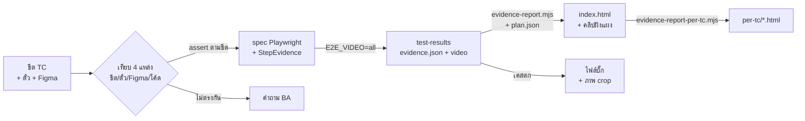

# tc-to-e2e-skill

**Claude skill** สำหรับ QA ที่มี test case แบบ manual อยู่ใน Google Sheet / Excel แล้วต้องการ:

1. แปลง TC เป็น spec **Playwright** แบบ 1 TC = 1 test โดยข้อความ Step / Expected ตรงกับชีตทุกตัวอักษร
2. เทียบ TC กับ **Figma, ตั๋ว และโค้ดจริง** ก่อนเขียน แล้วแยกให้ชัดว่าข้อไหนเป็นบั๊ก ยังไม่พัฒนา หรือต้องถาม BA
3. รันแล้วได้ **รายงานหลักฐาน 1:1** (Step ↔ Expected ↔ Actual ↔ ภาพ ↔ คลิป) พร้อมคลิป 1920×1080 ที่ฝังแผง Step ไว้
   พอส่งให้ลูกค้าหรือทีม ก็ดูรู้เรื่องได้โดยไม่ต้องเปิดโค้ด
4. ได้ไฟล์บั๊กพร้อมภาพ crop ที่ตีกรอบแดงและเขียนป้ายภาษาไทย ให้ dev อ่านจบในภาพเดียว

| ส่วน | ทำอะไร |
|---|---|
| [`tc-to-e2e/SKILL.md`](tc-to-e2e/SKILL.md) | ขั้นตอนที่ Claude ทำตาม: โหลด config → อ่านโค้ด → Figma → เขียน spec → รัน → รายงาน → บั๊ก |
| `scripts/evidence-report.mjs` | สร้างหน้ารายงานจาก `evidence.json` + `plan.json` และฝังแผง Step ลงคลิป |
| `scripts/evidence-report-per-tc.mjs` | แยกไฟล์ HTML 1 ไฟล์ต่อ 1 TC (ฝังคลิปและภาพไว้ในไฟล์ แนบส่งได้) |
| `scripts/annotate-bug-image.mjs` | crop ภาพบั๊ก + กรอบแดง + เลข + ป้ายภาษาไทย (render ผ่าน Chromium) |
| `assets/step-evidence.ts` | คลาสที่ spec ใช้เก็บหลักฐานต่อ step |
| `assets/TC_TO_E2E.template.md` | แม่แบบ config ของแต่ละโปรเจกต์ |

## ภาพรวมการทำงาน



สกิลนี้**ไม่ผูกกับโปรเจกต์ใด** ค่าเฉพาะของแต่ละโปรเจกต์ (path, คำสั่งรัน, env, บัญชี, ที่เก็บบั๊ก, ผู้รับคำถาม)
อยู่ในไฟล์ `TC_TO_E2E.md` ที่ commit ไว้ในโปรเจกต์นั้น

---

## สิ่งที่ต้องมี

- โปรเจกต์ที่ใช้ **Playwright** (TypeScript) อยู่แล้ว · Node 20 ขึ้นไป
- **ffmpeg ตัวเต็ม** (มี overlay filter + libvpx) ใช้สำหรับฝังแผงลงคลิป: `brew install ffmpeg`, `apt install ffmpeg`
  หรือ `@ffmpeg-installer/ffmpeg` ในโปรเจกต์ ffmpeg ที่มากับ Playwright ใช้ไม่ได้
- (แนะนำ) connector **Figma** และ **Google Sheets** ใน Claude ถ้าไม่มี สกิลจะขอ PNG และขอให้คุณกรอกผลลงชีตเอง

## โครงสร้าง repo

```
tc-to-e2e/                     ตัวสกิล (โฟลเดอร์นี้คือสิ่งที่ติดตั้ง)
  SKILL.md
  references/                  เอกสารที่ Claude เปิดอ่านเมื่อถึงขั้นนั้น
    figma-crosscheck.md        เทียบ TC / ตั๋ว / Figma / โค้ด และลำดับการตัดสิน
    spec-pattern.md            รูปแบบ spec 1:1 + StepEvidence + mock + fixme
    evidence-report.md         plan.json, สถานะแต่ละแถว, คำสั่ง, การตรวจคลิป, การเผยแพร่
    bug-report.md              ประเภทผล, รูปแบบไฟล์บั๊ก, ภาพ crop, คำถาม BA
  scripts/
    evidence-report.mjs        test-results → index.html + videos/ + shots/
    evidence-report/merge.mjs  รวม evidence กับ plan (pure, มีเทสต์)
    evidence-report/template.html
    evidence-report-per-tc.mjs
    annotate-bug-image.mjs
    lib/resolve.mjs            หา playwright / ffmpeg จากโปรเจกต์ที่รันคำสั่ง
  assets/                      ไฟล์ที่สกิลคัดลอกเข้าโปรเจกต์
    step-evidence.ts
    clip-use.ts
    example.spec.ts
    TC_TO_E2E.template.md
examples/                      plan.example.json, annotate.example.json
tools/
  install_claude_code.sh       ติดตั้งให้ Claude Code
  build_skill_zip.sh           สร้าง zip สำหรับอัปโหลดใน Claude Desktop / claude.ai
tests/                         node:test (ไม่ต้องใช้ browser หรือ ffmpeg)
```

---

## ติดตั้ง

```bash
git clone https://github.com/<owner>/tc-to-e2e-skill.git
cd tc-to-e2e-skill
```

### A) Claude Code

```bash
tools/install_claude_code.sh            # คัดลอกไป ~/.claude/skills (ใช้ได้ทุกโปรเจกต์)
tools/install_claude_code.sh --link     # symlink: git pull แล้วสกิลอัปเดตตาม
tools/install_claude_code.sh --project  # ติดตั้งลง ./.claude/skills ของโปรเจกต์ที่ยืนอยู่ (commit แชร์ทีมได้)
```

ตรวจว่าติดตั้งแล้ว: เปิด Claude Code แล้วพิมพ์ `/skills` ต้องเห็น `tc-to-e2e`

### B) Claude Desktop / claude.ai

```bash
tools/build_skill_zip.sh    # → dist/tc-to-e2e.zip
```

อัปโหลดได้ที่ Settings → Capabilities → Skills → Upload skill
สคริปต์ของสกิลต้องรันในเครื่องที่มีโปรเจกต์และ Playwright จึงใช้กับ Claude Code ได้ครบที่สุด

---

## เริ่มใช้ในโปรเจกต์ (ครั้งแรก)

1. เปิด Claude Code ในโปรเจกต์ แล้วสั่งงานแรกได้เลย ถ้ายังไม่มี `TC_TO_E2E.md` สกิลจะสร้างจากแม่แบบ
   โดยเติมค่าที่อ่านได้จากโปรเจกต์ ถามค่าที่เหลือ แล้วให้คุณยืนยันก่อนเริ่ม
2. ตรวจไฟล์ `TC_TO_E2E.md` แล้ว commit ไว้ให้ทีมใช้ร่วมกัน **ห้ามใส่รหัสผ่าน** ให้ใส่แค่ชื่อตัวแปร env
3. สกิลจะคัดลอก `step-evidence.ts` และ `clip-use.ts` ไปไว้ใน utils ของโปรเจกต์เมื่อใช้ครั้งแรก

## วิธีใช้

พิมพ์สั่งแบบไหนก็ได้:

```
/tc-to-e2e ชีต https://docs.google.com/spreadsheets/d/<id> แท็บ "หน้าแรก" ตั๋ว PROJ-12
ทำ auto TC จากชีตนี้ แท็บ "เมนูทางลัด" เฉพาะแถว Auto Candidate รันบน staging
```

สิ่งที่ได้กลับมา:
- spec ใน `tests/…` และ doc เทียบ TC / ตั๋ว / Figma / โค้ด
- โฟลเดอร์ `evidence-<ชื่อ>/` ที่มี `index.html` (เผยแพร่เป็น artifact ได้) และ `per-tc/<TC>.html`
- ไฟล์บั๊กพร้อมภาพ crop และรายการคำถามถึง BA
- ตารางสรุป Pass / Fail / Blocked / Not Run พร้อมเหตุผลต่อเคส

### ใช้สคริปต์ตรง ๆ โดยไม่ผ่าน Claude

ต้องรันจากโฟลเดอร์โปรเจกต์ e2e:

```bash
SKILL=~/.claude/skills/tc-to-e2e
E2E_VIDEO=all npx playwright test tests/home.spec.ts --workers=1 --retries=0
node $SKILL/scripts/evidence-report.mjs --out evidence-home --plan plan.json \
  --heading 'ผลทดสอบแท็บ "หน้าแรก"' --env 'staging' --account 'demo.teacher' test-results
node $SKILL/scripts/evidence-report-per-tc.mjs evidence-home --status Fail
node $SKILL/scripts/annotate-bug-image.mjs bugs/BUG-12.json
```

รูปแบบ `plan.json` และกติกาของแต่ละสถานะอยู่ที่ [references/evidence-report.md](tc-to-e2e/references/evidence-report.md)

---

## หลักที่สกิลยึด

- **assert ตาม Expected ในชีตเสมอ** ถ้าระบบทำต่างไปก็ปล่อยให้เคสตก แล้วจัดประเภทไว้ใน reason ห้ามแก้ Expected ให้ตรงกับระบบ
- **record ก่อน assert** แม้เคสตก รายงานก็ยังมีค่าที่หน้าจอแสดงจริง
- **ทุกแถวของชีตต้องอยู่ในรายงาน** รวมถึงขั้นที่ไม่ได้รันและเคส fixme
- **ตรวจคลิปด้วยตาก่อนส่ง** ต้องเป็น 1920×1080, แผงอ่านออก และไม่จบด้วยหน้าขาว

## ความปลอดภัย

- สกิลห้าม Claude เปิดหรืออ่านไฟล์ `.env*` · ตั้งค่าบัญชีผ่าน env และ storage state เท่านั้น
- login ครั้งเดียวต่อรอบ ถ้า login ไม่ผ่านจะหยุดถาม ไม่ลองซ้ำ (บัญชีอาจถูกล็อก หรือเตะผู้ใช้จริงออก)
- ไม่ commit, ไม่ push, ไม่สร้างข้อมูลบน env และไม่เขียนลงชีตโดยไม่ถามก่อน
- รายงานมีภาพหน้าจอจริงของระบบ ก่อนเผยแพร่ต้องตรวจว่าไม่มีข้อมูลส่วนบุคคลที่ไม่ควรออกไป

## ข้อจำกัด

- ฝังแผงลงคลิปได้เฉพาะเมื่อมี ffmpeg ตัวเต็ม ถ้าไม่มีคลิป รายงานจะยังสร้างได้ แต่จะไม่มีวิดีโอ
- ฟอนต์ของแผงและหน้ารายงานโหลดจาก Google Fonts ถ้าเครื่องออฟไลน์ ภาษาไทยในแผงอาจใช้ฟอนต์สำรอง
- เทสต์ใน repo ครอบคลุมการรวม plan, การ render หน้า และการแยกไฟล์รายข้อ แต่ไม่ได้รัน Chromium หรือ ffmpeg

## พัฒนาและรันเทสต์

```bash
npm test
```
